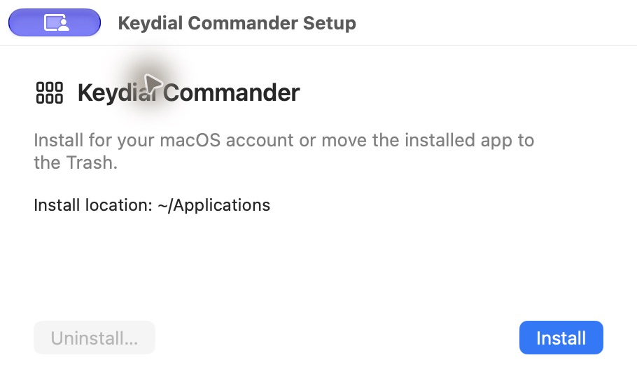
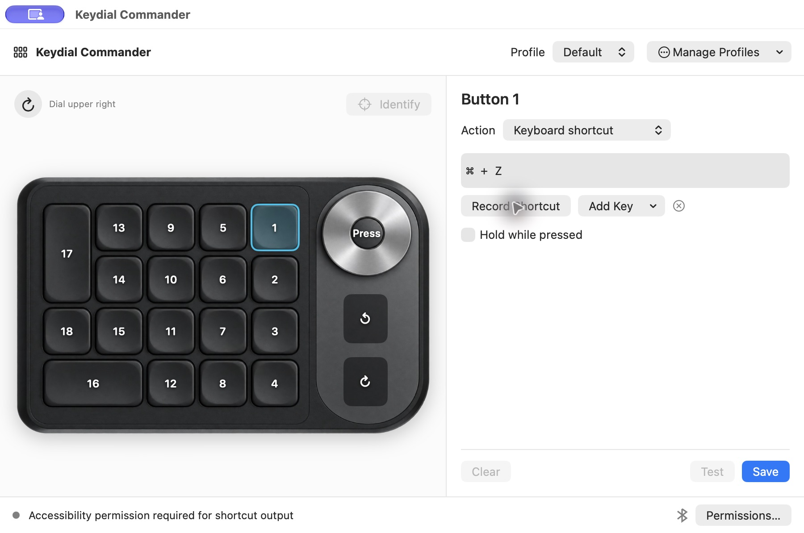
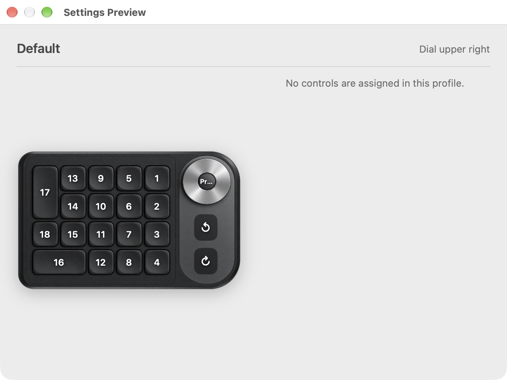

# Install and use Keydial Commander on macOS

[**Download Keydial Commander 1.3.1 for Apple Silicon (.dmg)**](https://github.com/martin-geek/KeydialCommander/releases/download/v1.3.1-macos/Keydial.Commander-1.3.1-macOS-arm64.dmg)

Requires an Apple Silicon Mac running macOS 14 or later and a Huion Keydial Mini
(K20). The installer bundles everything you need to run the desktop app.

## Install and open Commander

The linked 1.3.1 installer uses your home Applications folder
(`~/Applications`) and only detects the K20 over Bluetooth. The steps below
describe Setup 1.3.5, which you can build using the instructions on this page.

1. Download the DMG above and double-click it in Finder.
2. In the mounted disk image, double-click **Keydial Commander Setup**.
3. Click **Install**. For an update, quit Commander completely and choose
   **Reinstall**. Setup confirms the installed version in **Applications**, or
   displays the error if it cannot finish. Dismiss the message and click
   **Open App**.
4. To find Commander later, open **Applications** in Finder and double-click
   **Keydial Commander.app**, or search for it in Spotlight.



If you still have a copy in `~/Applications` after installing 1.3.5,
move the older copy to the Trash in Finder
so macOS opens the new one. Your profiles and settings are kept.

The release is an unnotarized preview. If macOS blocks a downloaded copy,
review the message in **System Settings → Privacy & Security**. If macOS offers
**Open Anyway**, use it only after confirming you downloaded the installer
from this repository. [Apple’s guide to opening apps safely](https://support.apple.com/en-us/102445)

## Grant permissions and connect the K20

1. Commander opens **Set Up Keydial Permissions** when it starts and detects
   missing access. You can reopen it with **Permissions…** in the menu bar.
   Click **Shortcut Output Settings…**, or open **System Settings →
   Privacy & Security** manually. On **macOS 27 Golden Gate**, open **Device
   Control and Data Access**. On earlier macOS versions, open **Accessibility**.
   Enable **Keydial Commander** so it can send the shortcuts you assign.
   Commander calls this permission **Accessibility** in its status message.
2. Click **Input Monitoring Settings…** or open **Input Monitoring** in
   **Privacy & Security** and enable
   **Keydial Commander** so it can read the keypad’s buttons and dial. If
   Commander is missing from either list, click **+**, press
   **Shift–Command–G**, enter `/Applications`, and select
   **Keydial Commander.app**.
3. Choose **Quit Commander** from the menu bar icon or press **Command–Q**.
   Reopen the installed app. Pair the K20 in **System Settings → Bluetooth**
   or connect it using a USB data cable.
4. Once Commander shows **Keydial Mini connected**, click **Identify** and press
   a physical key. Commander should select its matching control. If capture
   fails, quit the Huion utility and any other K20 remapper, then reconnect.

[Golden Gate permission names](https://support.logi.com/hc/en-001/articles/1500005514962-Logi-Options-permissions-on-macOS)
· [Apple’s Accessibility guide](https://support.apple.com/guide/mac-help/mh43185/mac)
· [Apple’s Input Monitoring guide](https://support.apple.com/guide/mac-help/mchl4cedafb6/mac)

### Commander still asks for permission after you enable it

macOS can retain a permission entry for an earlier build of Commander. The
switch can appear on while macOS rejects shortcut output from the installed
copy. Refresh the entry for the installed app.

1. Quit Commander with **Command–Q**.
2. In **System Settings → Privacy & Security → Device Control and Data
   Access** (**Accessibility** on macOS 26 and earlier), select the
   **Keydial Commander** row and click **−**.
3. Click **+**, press **Shift–Command–G**, enter `/Applications`, and select
   **Keydial Commander.app**. Turn on its switch.
4. Reopen Commander from that folder. If Commander then asks for **Input
   Monitoring** while its switch is already on, repeat the removal and
   re-add steps in **Input Monitoring**, then quit and reopen Commander.

### macOS blocked exclusive keypad access

When Commander shows **Identify only** with a USB connection, click
**Enable USB Remapping…** and confirm. This switches the K20 to tablet mode
and lets Commander handle the controls. To restore factory shortcuts, quit
Commander, unplug the USB cable, and turn the K20 off and back on.

The pictured control flashes when you press it, even without a saved
binding. **Identify** also selects the control for editing.

## How to use the app

### Assign your first shortcut

1. Click a button on the pictured keypad. For the dial, choose **Press**,
   clockwise, or counterclockwise.
2. Set **Action** to **Keyboard shortcut**, click **Record Shortcut**, and press
   the combination on your Mac keyboard. Try **Command–Z** to map Undo. You can
   also choose keys individually with **Add Key**.
3. Click **Save**. The mapping appears on the keycap and its full label is
   available on hover. Click **Test** to send the action, or switch to an app
   where you can safely try it and press the physical key.
4. Use **Hold while pressed** for an action that should stay down while you hold
   the physical key. To remove a binding, select its control and click **Clear**.



The **Action** menu also supports macros, opening an app or URL, running a
command, and switching profiles.

### Rotate the keypad and open the preview

Click the circular arrow above the keypad image to rotate it 90° clockwise.
Commander remembers the orientation and keeps each binding with its physical key.

Open **Keydial → Settings Preview** from the app’s menu, or choose
**Settings Preview** from the Commander icon in the macOS menu bar. To open the
guide from the keypad itself, select a button, set **Action** to
**Show Settings Preview**, and click **Save**. The preview shows the active
profile and lists its saved mappings.



### Manage profiles and use the menu bar

- Select a profile at the top of the editor. Use **Manage Profiles** to
  create, duplicate, rename, or delete a profile.
- Choose **Export Profile…** to save a YAML backup. Choose **Import Profile…**
  to load it under a profile name. Each export contains the selected profile’s
  bindings.
- Open **Manage Profiles → App Profiles…**, click **Add App…**, and select a Mac
  app. Pick the profile to use when it is in front. Use **All other apps** to
  choose the fallback profile.
- Click Commander’s keypad icon in the macOS menu bar to see the running
  version, open the editor, show the preview, rotate the keypad, change
  profiles, or quit. **Appearance**
  offers **System**, **Light**, and **Dark**.
- The status area shows a blue Bluetooth symbol or a USB connector for the
  active connection. It shows a battery percentage and charging indicator
  when the keypad reports them. If Bluetooth battery data is unavailable,
  click **Read Bluetooth Battery** next to the indicator.

## Uninstall

Quit Commander, reopen **Keydial Commander Setup** from the DMG, and choose
**Uninstall…**. Setup moves Commander to the Trash. Your saved profiles and
orientation are kept.

## Build the disk image

From a macOS development checkout with Python 3 and the Apple Command Line
Tools, run:

```sh
python3 -m venv .venv
.venv/bin/python -m pip install --upgrade pip setuptools wheel
.venv/bin/python -m pip install -e . 'pyinstaller>=6,<7'
bash packaging/macos/build.sh
```

The disk image is written under `dist/`. This build uses local ad hoc code
signing. macOS may ask for permission again after replacing an ad hoc build.
For public distribution, use the same Developer ID Application identity for
each build so macOS can recognize the updated app. Set
`KEYDIAL_SIGNING_IDENTITY` to that identity and `KEYDIAL_NOTARY_PROFILE` to
a keychain profile configured with Apple’s `notarytool`. The build signs the
bundled service and apps, submits the disk image, and staples the approved
ticket. [Apple’s signing guidance](https://developer.apple.com/documentation/xcode/creating-distribution-signed-code-for-the-mac)
· [Apple’s notarization guidance](https://developer.apple.com/documentation/security/notarizing-macos-software-before-distribution)

See the [macOS changelog](../packaging/macos/CHANGELOG.md) for version history.

## Optional browser preview

The earlier browser preview is still available for development. Both macOS
editors use the same profile files.

Use macOS 11 or later, a supported Python 3 with pip, Node.js 24 or later,
and the Apple Command Line Tools (`xcode-select --install`). Run these commands
from the checkout in Terminal:

```sh
python3 -m venv .venv
.venv/bin/python -m pip install --upgrade pip
npm --prefix web ci
npm --prefix web run build
.venv/bin/python -m pip install .
.venv/bin/huion-keydial-mini --open
```

The editor defaults to [127.0.0.1:8137](http://127.0.0.1:8137).
Leave Terminal running while you use the keypad. Press Control+C in Terminal
to stop remapping and release the keypad. Profiles are saved under
`~/.config/huion-keydial-mini/profiles/`.

### Connect the keypad from the browser preview

1. Pair the K20 in **System Settings → Bluetooth**, or connect it with a USB
   data cable.
2. In **System Settings → Privacy & Security**, enable **Input Monitoring**
   and **Device Control and Data Access** (called **Accessibility** on macOS 26
   and earlier) for the terminal application you use to run Commander. Quit
   and reopen that terminal, then start Commander again.
3. Use the editor’s **Identify** mode to check the 18 buttons, both dial
   directions, and the dial click. Then assign a shortcut to a button and try
   it in a text editor. For example, Command+A uses `KEY_LEFTMETA+KEY_A`.

If the status shows **Cannot access K20 input**, quit other keypad remappers
or the Huion utility if it controls the K20, then reconnect the keypad.
Commander waits for all expected controls before activating a capture
session. The macOS backend matches Huion vendor ID `0x256c` with product
ID `0x8251` over Bluetooth or `0x0069` over USB. Version 1.3.1 only
matched the Bluetooth ID and showed a wired K20 as disconnected.

**Open URL** uses `/usr/bin/open` with the URL as its argument. **Launch app**
uses `/usr/bin/open` with two arguments, `-a` and the app name. Imported
profiles retain their original key names and command arguments. Edit
platform-specific bindings after import. The key picker lists the keys the
local backend can emit.

Physical Bluetooth and USB input, media output, and reconnect behavior still
need an end-to-end test with macOS privacy permissions granted.
